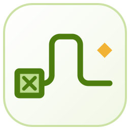

<div align="center">

<picture>
  <source media="(prefers-color-scheme: dark)" srcset="brand/datum-logo-light.svg">
  
</picture>

<h1 hidden>Datum</h1>

**Free, open-source desktop tools for engineers, scientists, researchers and analysts.**

Small, fast apps that do serious technical work, written from scratch in Rust, with one look and one way of working.<br>
No accounts, no subscriptions, no telemetry: your files stay on your computer.

[](https://edgar-mendonca.github.io/Datum/)
[](LICENSE)
[](https://edgar-mendonca.github.io/Datum/#apps)
[](https://github.com/Edgar-Mendonca/Datum/actions/workflows/pages.yml)

</div>

## The apps

| | App | What it is for | Latest | |
| :---: | --- | --- | --- | --- |
|  | **[Datum Plan](https://edgar-mendonca.github.io/Datum/apps/plan)** | Plan, schedule, track and report projects. For project managers, planners, engineers and contractors. | [](https://github.com/Edgar-Mendonca/Datum-Plan/releases/latest) | [Download](https://github.com/Edgar-Mendonca/Datum-Plan/releases/latest) · [Repo](https://github.com/Edgar-Mendonca/Datum-Plan) |
|  | **[Datum Plot](https://edgar-mendonca.github.io/Datum/apps/plot)** | Analyse data and make publication-ready graphs. For scientists, researchers, lab teams and students. | [](https://github.com/Edgar-Mendonca/Datum-Plot/releases/latest) | [Download](https://github.com/Edgar-Mendonca/Datum-Plot/releases/latest) · [Repo](https://github.com/Edgar-Mendonca/Datum-Plot) |
|  | **[Datum Atlas](https://edgar-mendonca.github.io/Datum/apps/atlas)** | Choose materials with property charts and selection indices. For design and materials engineers, and students. | [](https://github.com/Edgar-Mendonca/Datum-Atlas/releases/latest) | [Download](https://github.com/Edgar-Mendonca/Datum-Atlas/releases/latest) · [Repo](https://github.com/Edgar-Mendonca/Datum-Atlas) |
|  | **[Datum Sim](https://edgar-mendonca.github.io/Datum/apps/sim)** | Model and simulate dynamic systems: block diagrams, control and motors. For control, mechanical, electrical, process and mechatronics engineers. | [](https://github.com/Edgar-Mendonca/Datum-Sim/releases/latest) | [Download](https://github.com/Edgar-Mendonca/Datum-Sim/releases/latest) · [Repo](https://github.com/Edgar-Mendonca/Datum-Sim) |
|  | **[Datum Calc](https://edgar-mendonca.github.io/Datum/apps/calc)** | Engineering calculations with real units, readable maths, checks and a printable calc sheet. For every engineer who writes calculations. | [](https://github.com/Edgar-Mendonca/Datum-Calc/releases/latest) | [Download](https://github.com/Edgar-Mendonca/Datum-Calc/releases/latest) · [Repo](https://github.com/Edgar-Mendonca/Datum-Calc) |
|  | **[Datum Mesh](https://edgar-mendonca.github.io/Datum/apps/mesh)** | Finite-element analysis: stresses, deflections and temperatures in parts and frames, with a verification report. For mechanical, structural and process engineers. | [](https://github.com/Edgar-Mendonca/Datum-Mesh/releases/latest) | [Download](https://github.com/Edgar-Mendonca/Datum-Mesh/releases/latest) · [Repo](https://github.com/Edgar-Mendonca/Datum-Mesh) |
|  | **[Datum Pipe](https://edgar-mendonca.github.io/Datum/apps/pipe)** | Pipe stress analysis: displacements, support and nozzle loads, code stresses and an automatic isometric. For piping, stress and plant engineers. | [](https://github.com/Edgar-Mendonca/Datum-Pipe/releases/latest) | [Download](https://github.com/Edgar-Mendonca/Datum-Pipe/releases/latest) · [Repo](https://github.com/Edgar-Mendonca/Datum-Pipe) |

Each app has its own page on the [website](https://edgar-mendonca.github.io/Datum/) (click its name): what it does, how it is used, screens, roadmap and releases.

**[Datum Home](home)** installs, updates, opens and removes all of them from one small window, checking for new versions when you open it. Prefer a single app? Download it on its own from the table above.

Every app is free and open source (MIT), Windows first, installs in seconds for your user account (no administrator rights) and updates itself.

## Why Datum

- **Small and fast.** Quick to install, opens in a moment, smooth with large files.
- **Private.** Your files stay on your computer. The only network call is the update check.
- **Built for real technical work.** Each app has its own tested engine: scheduling, statistics, materials selection, system simulation, calculation, finite elements, pipe stress.
- **One design.** The same window, ribbon, help, printing and updater in every app. Learn one, know them all.
- **Free forever.** MIT licence, built in the open.

## Principles

- **Engine first.** All calculation lives in a pure Rust crate (`crates/core`) with unit tests; the window only shows what the engine computes.
- **One window style.** A Tauri 2 shell with a SolidJS window, IBM Plex type and one set of colour tokens; only the accent and the logo glyph change.
- **Small releases.** One release is one small numbered version (0.1.0, 0.1.1, …), shown in the in-app updater with its notes.
- **Written down.** Every repo keeps `CLAUDE.md`, `docs/MEMORY.md` (decisions, roadmap, session log) and a plain-language `CHANGELOG.md`.

## How the family is built

- [**FAMILY.md**](FAMILY.md): the shared design guide (stack, colour, type, logo, window, components, printing, releases, docs, workflow).
- [**MEMORY.md**](MEMORY.md): the family memory: decisions that apply to every app, the apps list, the session log.
- [**apps.json**](apps.json): the registry the website builds from. Adding an app is one line.
- [**brand/**](brand): the Datum logo ("Continuum") and its guide [BRAND.md](brand/BRAND.md), and every app icon.
- [**briefs/**](briefs): the briefs new apps start from: [Datum Sim](briefs/DATUM-SIM.md) (released), [Datum Calc](briefs/DATUM-CALC.md) and [Datum Mesh](briefs/DATUM-MESH.md) (released), [Datum Pipe](briefs/DATUM-PIPE.md) (released).
- [**brain/**](brain): the Datum brain: `graph.json`, one graph of every app, design rule, technology, source file, decision, release, plan and session, generated from the repositories ([BRAIN.md](brain/BRAIN.md)). Read it before starting anything new.
- [**home/**](home): **Datum Home**, the desktop app that installs and updates the others (Tauri, a tested Rust core, a SolidJS window); released from this repository with tags `home-vX.Y.Z`.
- [**site/**](site): the website (Astro): the landing page, one page per app (`/apps/<id>`) and the interactive [Datum network](https://edgar-mendonca.github.io/Datum/network). It reads each app's `docs/site.json`, `CHANGELOG.md`, latest release and the brain when it builds, every hour and on every push.

### Starting a new app

1. Create `Edgar-Mendonca/Datum-<Name>` (MIT) and copy the skeleton from Datum Plan ([FAMILY §12](FAMILY.md#12-starting-a-new-datum-app-checklist)).
2. Rename the product, identifier, file extension, updater repo and installer name.
3. Pick an accent from [FAMILY §3](FAMILY.md#3-colour) and draw the logo per [§5](FAMILY.md#5-logo-and-branding); copy it into `brand/`.
4. Write `docs/MEMORY.md` and `docs/PLAN-0.1.md` before building features.
5. Release 0.1.0 so the updater works from day one.
6. Publish `docs/site.json` (with `about` and `steps` for its page) and add the app to `apps.json`.

## Build the site

```bash
cd site
npm ci
npm run build      # works without a token; set GITHUB_TOKEN to read releases without rate limits
npm run preview    # http://localhost:4321/Datum/
```

Regenerate the brain file with `node brain/brain.mjs` (from the repo root).

GitHub Pages must use **Settings › Pages › Source: GitHub Actions** (the workflow in `.github/workflows/pages.yml` builds and deploys the site).

## Contribute and feedback

- Bugs and feature requests: open an issue in the app's repository ([Plan](https://github.com/Edgar-Mendonca/Datum-Plan/issues/new), [Plot](https://github.com/Edgar-Mendonca/Datum-Plot/issues/new), [Atlas](https://github.com/Edgar-Mendonca/Datum-Atlas/issues/new), [Sim](https://github.com/Edgar-Mendonca/Datum-Sim/issues/new), [Calc](https://github.com/Edgar-Mendonca/Datum-Calc/issues/new), [Mesh](https://github.com/Edgar-Mendonca/Datum-Mesh/issues/new), [Pipe](https://github.com/Edgar-Mendonca/Datum-Pipe/issues/new)).
- Ideas for new Datum apps, and anything about the family or this site: [open an issue here](https://github.com/Edgar-Mendonca/Datum/issues/new).

## Licence

MIT © 2026 Edgar Mendonca. See [LICENSE](LICENSE).
