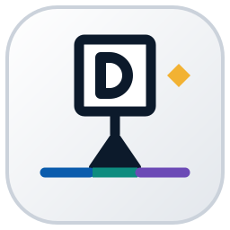
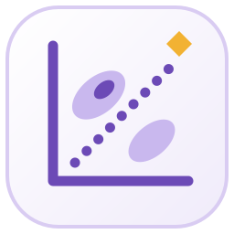

<div align="center">



# Datum

**Free, open-source desktop tools for engineers, scientists, researchers and analysts.**

Small, fast apps that do serious technical work, written from scratch in Rust, with one look and one way of working.<br>
No accounts, no subscriptions, no telemetry: your files stay on your computer.

[](https://edgar-mendonca.github.io/Datum/)
[](LICENSE)
[](https://edgar-mendonca.github.io/Datum/about)
[](https://github.com/Edgar-Mendonca/Datum/actions/workflows/pages.yml)

</div>

## The apps

| | App | What it is for | Latest | |
| :---: | --- | --- | --- | --- |
|  | **[Datum Plan](https://edgar-mendonca.github.io/Datum/plan)** | Plan, schedule, track and report projects. For project managers, planners, engineers and contractors. | [](https://github.com/Edgar-Mendonca/Datum-Plan/releases/latest) | [Download](https://github.com/Edgar-Mendonca/Datum-Plan/releases/latest) · [Repo](https://github.com/Edgar-Mendonca/Datum-Plan) |
|  | **[Datum Plot](https://edgar-mendonca.github.io/Datum/plot)** | Analyse data and make publication-ready graphs. For scientists, researchers, lab teams and students. | [](https://github.com/Edgar-Mendonca/Datum-Plot/releases/latest) | [Download](https://github.com/Edgar-Mendonca/Datum-Plot/releases/latest) · [Repo](https://github.com/Edgar-Mendonca/Datum-Plot) |
|  | **[Datum Atlas](https://edgar-mendonca.github.io/Datum/atlas)** | Choose materials with property charts and selection indices. For design and materials engineers, and students. | [](https://github.com/Edgar-Mendonca/Datum-Atlas/releases/latest) | [Download](https://github.com/Edgar-Mendonca/Datum-Atlas/releases/latest) · [Repo](https://github.com/Edgar-Mendonca/Datum-Atlas) |

Every app is free and open source (MIT), Windows first, installs in seconds for your user account (no administrator rights) and updates itself.

## Why Datum

- **Small and fast.** Quick to install, opens in a moment, smooth with large files.
- **Private.** Your files stay on your computer. The only network call is the update check.
- **Built for real technical work.** Each app has its own engine, tested, for scheduling, statistics or materials selection.
- **One design.** The same window, ribbon, help, printing and updater in every app. Learn one, know them all.
- **Free forever.** MIT licence, built in the open.

## Principles

- **Engine first.** All calculation lives in a pure Rust crate (`crates/core`) with unit tests; the window only shows what the engine computes.
- **One window style.** A Tauri 2 shell with a SolidJS window, IBM Plex type and one set of colour tokens; only the accent and the logo glyph change.
- **Small releases.** One release is one small numbered version (0.1.0, 0.1.1, …), shown in the in-app updater with its notes.
- **Written down.** Every repo keeps `CLAUDE.md`, `docs/MEMORY.md` (decisions, roadmap, session log) and a plain-language `CHANGELOG.md`.

## How the family is built

- [**FAMILY.md**](FAMILY.md): the shared design guide (stack, colour, type, logo, window, components, printing, releases, docs, workflow).
- [**MEMORY.md**](MEMORY.md): the family memory: decisions that apply to every app, the apps list, the session log.
- [**apps.json**](apps.json): the registry the website builds from. Adding an app is one line.
- [**brand/**](brand): the family mark and every app icon.
- [**site/**](site): the website (Astro). It reads each app's `docs/site.json`, `CHANGELOG.md` and latest release when it builds, every day and on every push.

### Starting a new app

1. Create `Edgar-Mendonca/Datum-<Name>` (MIT) and copy the skeleton from Datum Plan ([FAMILY §12](FAMILY.md#12-starting-a-new-datum-app-checklist)).
2. Rename the product, identifier, file extension, updater repo and installer name.
3. Pick an accent from [FAMILY §3](FAMILY.md#3-colour) and draw the logo per [§5](FAMILY.md#5-logo-and-branding); copy it into `brand/`.
4. Write `docs/MEMORY.md` and `docs/PLAN-0.1.md` before building features.
5. Release 0.1.0 so the updater works from day one.
6. Publish `docs/site.json` and add the app to `apps.json`.

## Build the site

```bash
cd site
npm ci
npm run build      # works without a token; set GITHUB_TOKEN to read releases without rate limits
npm run preview    # http://localhost:4321/Datum/
```

## Contribute and feedback

- Bugs and feature requests: open an issue in the app's repository ([Plan](https://github.com/Edgar-Mendonca/Datum-Plan/issues/new), [Plot](https://github.com/Edgar-Mendonca/Datum-Plot/issues/new), [Atlas](https://github.com/Edgar-Mendonca/Datum-Atlas/issues/new)).
- Ideas for new Datum apps, and anything about the family or this site: [open an issue here](https://github.com/Edgar-Mendonca/Datum/issues/new).

## Licence

MIT © 2026 Edgar Mendonca. See [LICENSE](LICENSE).
